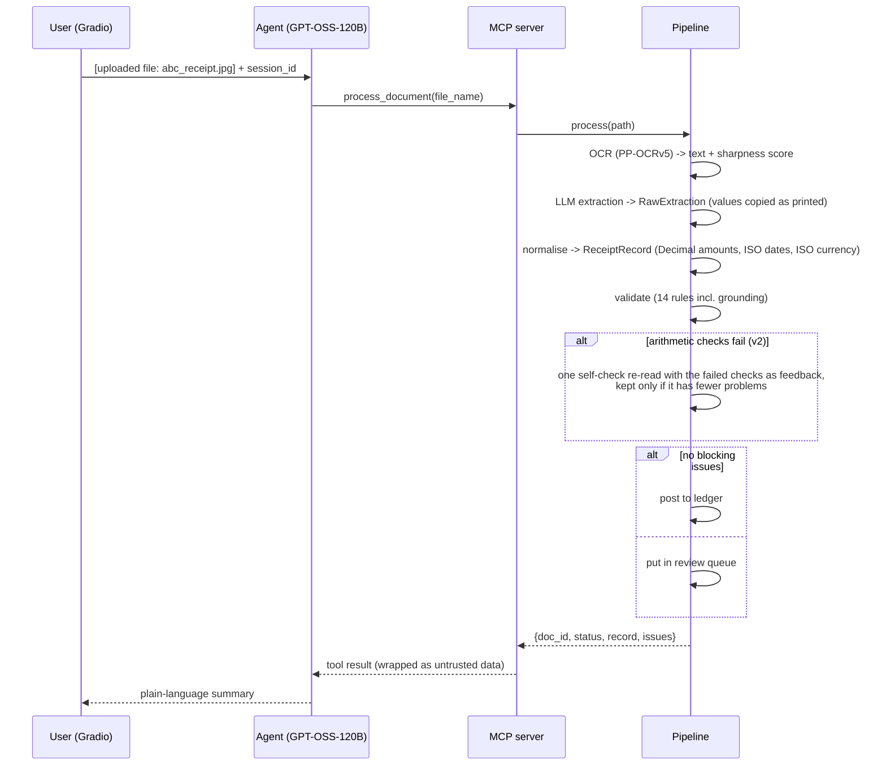
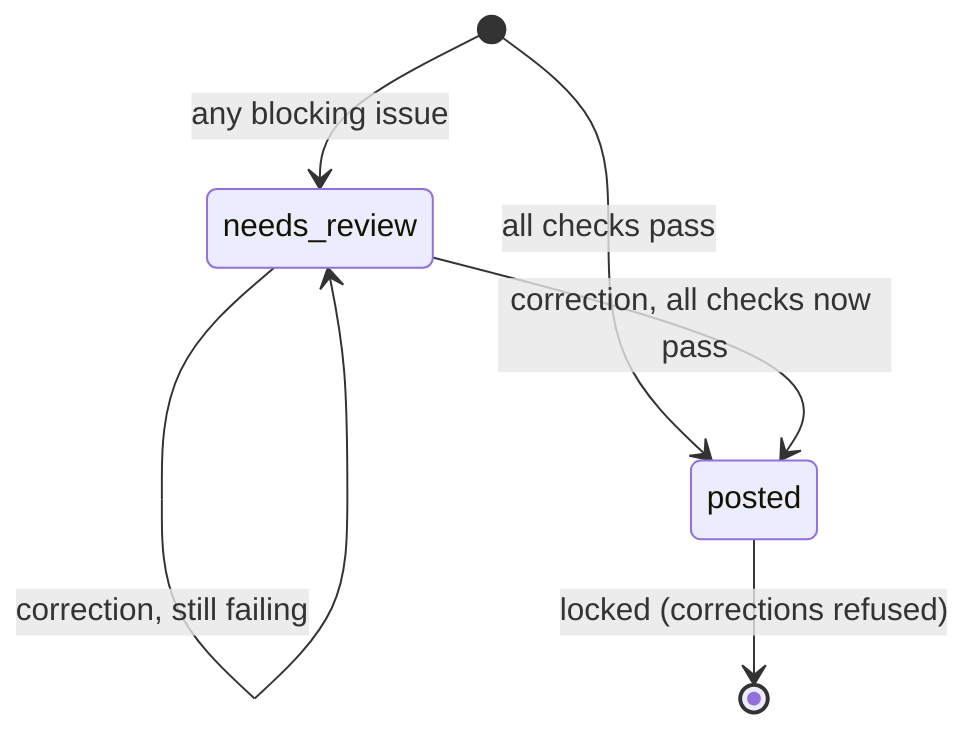

# Design

This document covers the flow, the state, why each choice was made, and the models with their
cost and latency. The goal throughout was a small system that is **safe by construction**: an
LLM reads the document, but deterministic code decides what reaches the ledger.

## 1. Flow

### Processing a document



| Step | Input → output | Why it's a separate step |
|---|---|---|
| **OCR** ([core/ocr.py](core/ocr.py)) | image/PDF → text in reading order, confidence, sharpness | A PDF with a text layer skips OCR. Boxes are grouped into printed lines so a label and its amount stay together. A sideways page is detected and re-read rotated (v2). |
| **Extract** ([core/extract.py](core/extract.py)) | OCR text → `RawExtraction` (strings) | The model only *copies* values as printed; it never converts or calculates. Output uses JSON mode and is validated with Pydantic; on failure the error is fed back, up to 3 attempts. |
| **Normalise** ([core/normalize.py](core/normalize.py)) | strings → typed `ReceiptRecord` | Number and date parsing is deterministic and unit-tested: `60.000` (IDR) = 60000, `9.000` (MYR) = 9, `25/12/18` is day-first. A value that was printed but can't be parsed is flagged, never silently dropped. |
| **Validate** ([core/validate.py](core/validate.py)) | record + OCR text → issues | Pure functions with no model calls; see section 3. |
| **Decide** ([core/pipeline.py](core/pipeline.py)) | issues → `posted` or `needs_review` | `_save` is the **only** code path that writes to the ledger. |

### Correcting a field in chat

```
User:  The vendor on that receipt is Kedai Kopi Maju.
Agent: correct_field(doc_id="DOC-07A4BC97", field="vendor_name", value="Kedai Kopi Maju")
         -> allow-list check (status, for example, can't be "corrected")
         -> parse with the same normalisers as extraction
         -> audit row: old value, new value, session, time
         -> field marked human-verified (skips grounding: OCR may contain the misread value)
         -> full re-validation -> posted / still needs review (with the remaining reasons)
Agent: "Vendor updated. All checks pass; posted as LEDGER-3F2A1C."
```

The agent resolves "that receipt" from the conversation, which is why each session's history
is kept. If it's ambiguous, the system prompt tells the agent to ask.

## 2. State

All state lives in one SQLite file ([core/store.py](core/store.py)):

| Table | Holds | Notes |
|---|---|---|
| `documents` | one row per upload: file hash, OCR text, quality, current record, issues, status | `prior_issues` (from normalisation) and `verified_fields` are kept so a correction can re-validate exactly |
| `corrections` | audit trail: doc, field, old value, new value, session, time | append-only |
| `ledger` | the "finance system": posted entries | `doc_id` is unique, so a record is posted at most once |
| `messages` | chat history per `session_id` | only user text and final answers are stored (not tool calls), which keeps the context small and stops untrusted tool output from accumulating |

**Record lifecycle:**



**Session ID:** the UI creates one per browser tab and shows it on the page. The agent sets it on
every tool call itself; the model never sees or chooses it, so one session can't act as
another. Traces carry the same ID, so a conversation can be followed end to end.

## 3. Validation rules

| Flag | Rule | Blocks posting? |
|---|---|---|
| `MISSING_FIELD` | vendor, date, total, currency (and invoice number on invoices) | yes |
| `UNPARSEABLE_VALUE` | a value was printed but can't be read | yes |
| `EXTRACTION_FAILED` | no text, or no valid JSON after 3 attempts, or LLM unavailable | yes |
| `BAD_AMOUNT` | total ≤ 0 | yes |
| `LINE_MATH` | qty × unit price ≠ line amount | yes |
| `LINE_SUM_MISMATCH` | line items match neither the subtotal nor the total in any known layout | yes |
| `TOTAL_MISMATCH` | subtotal + tax + adjustments ≠ total; tax-inclusive and tax-exclusive layouts are both accepted | yes |
| `TAX_RATE_ODD` | tax < 0 or > 30% of the base | yes |
| `BAD_DATE` / `STALE_DATE` | in the future / older than 730 days | yes |
| `BAD_CURRENCY` | not a supported currency | yes |
| `UNGROUNDED_VALUE` | the total, subtotal, tax or date doesn't appear in the OCR text | yes |
| `LOW_QUALITY` | sharpness < 10 or OCR confidence < 0.6 | yes |
| `DUPLICATE` | same file hash, or same vendor + date + total already posted | yes |
| `POSSIBLE_INJECTION` | instruction-like text in the document or the extracted fields | yes |
| `NOT_A_RECEIPT` | the model classified it as `other` | yes |
| `CURRENCY_INFERRED` | none printed; home currency assumed | no (warning) |
| `IMPLAUSIBLE_VALUE` | rounding > 1% of the total, treated as an OCR misread and ignored | no (warning) |

**Calibrated, not guessed:**
- **Sharpness threshold of 10.** On 24 real images, originals scored 22–4187 and heavily
  blurred copies scored 1–6. Mean OCR confidence turned out to be useless as a quality
  signal: blurred images still averaged 0.9 or more, because the few words that survive are
  read confidently.
- **Arithmetic tolerance.** max(0.02, 0.1% of the amount). This covers 5-sen cash rounding (MYR)
  and rupiah rounding on large IDR totals.

## 4. Why each choice

| Decision | Alternative considered | Why this one |
|---|---|---|
| **The LLM copies values; code parses them** | Ask the LLM for typed numbers and dates | Parsing becomes testable and locale-aware. The v1 eval found two parsing bugs, and each was fixed once with a regression test instead of prompt-tuning. |
| **Deterministic validation decides; no post/approve tool** | Let the agent decide, or give it a `post_to_ledger` tool | Even a fully hijacked model can't post a bad record. The injection tests simulate a model that *obeys* the injected text, and the record is still blocked. |
| **Grounding check**: key values must appear in the OCR text | Trust the model | Catches hallucinated or injected values. It's also what makes the v2 self-check safe: the model can't "fix" a receipt by inventing numbers that aren't printed. |
| **OCR first, then a text LLM** | A vision LLM reading the image | The chosen primary model (GPT-OSS-120B) is text-only. OCR text also makes grounding possible and keeps latency and cost predictable. |
| **PP-OCRv5 mobile through RapidOCR/ONNX** | PaddleOCR (paddlepaddle), Tesseract | Pip-only (no system packages; works on Windows and in a slim Docker image), CPU, ~15 MB of models, 1–5 s per receipt. Detection and recognition are the v5 mobile models. |
| **MCP over stdio, one long-lived connection** | Spawn a server per request, or HTTP | The OCR model loads once (first call ~13 s, then ~1–5 s). Stdio needs no ports, and tests connect in-process to the same server object. |
| **Only allow-listed tool errors reach the model** (`ToolError`) | Show all exceptions | The model gets actionable messages ("Could not read 'abc' as an amount"); unexpected crashes stay hidden from it (MCP 2.x default). |
| **Paths limited to the upload folder, basename only** | Accept any path | `process_document("../../.env")` is rejected; tested. |
| **Untrusted text is wrapped in `<untrusted_document>` tags** that it can't close early | Plain concatenation | Defence in depth. The prompt rule is a *signal*; the guarantees come from the decision being in code. |
| **Chat history = user text + final answers only** | Store full tool transcripts | Smaller context and cheaper turns, and untrusted tool output doesn't pile up across turns. The answers carry the doc IDs needed for later references. |
| **SQLite** | Postgres | Zero setup and one file to back up. Fine for a demo; swap it out in production (see README). |
| **Gradio on Hugging Face Spaces (Docker)** | Streamlit, Render | Free, native chat and upload components, and the same Dockerfile runs locally and in CI. |

## 5. Models: choice, cost and latency

MODEL_TABLE

## 6. Guardrails

| Guardrail | Where | Value |
|---|---|---|
| LLM request timeout | `core/llm.py` | 30 s (`LLM_TIMEOUT_S`) |
| Retries with exponential backoff (429/5xx/timeouts) | OpenAI SDK, `core/llm.py` | 2 (`LLM_MAX_RETRIES`; evals use 6 to wait out free-tier limits) |
| Provider fallback | `core/llm.py` | Groq → Gemini on timeout, connection, rate-limit, 5xx or auth errors |
| Structured output | `core/extract.py` | JSON mode + Pydantic (`extra="forbid"`, length limits) + up to 3 attempts with the validation error fed back |
| Max agent steps per turn | `agent/agent.py` | 8 LLM calls |
| Turn time limit | `agent/agent.py` | 120 s |
| Tool call timeout | `agent/mcp_client.py` | 120 s |
| Input size | `core/extract.py`, `core/ocr.py` | 12,000 OCR characters, 3 PDF pages |

## 7. Security

- **Untrusted inputs:** user chat text, OCR text from images and PDF text layers. All three
  reach the model only as data: OCR text and tool results are wrapped, and user
  corrections pass through the same allow-list and parsers as extracted values.
- **Prompt injection:** 9 detection patterns plus the structural guarantees above. Tests:
  `tests/test_pipeline.py::test_prompt_injection_obeyed_by_llm_is_still_never_posted`,
  `::test_injected_document_cannot_be_posted_through_chat_corrections`, and the
  `prompt_injection` eval case.
- **Secrets:** read only from environment variables. `.env` is git-ignored, `.dockerignore`
  keeps it out of the image, and CI runs gitleaks over the full history.
- **PII in logs:** every trace line passes through `mask_pii` (emails, card and account
  numbers keep only their last 4 digits, phone numbers, labelled names such as
  `Cashier:`/`Bill To:`). Traces store metadata (latency, tokens, cost, issue codes), never the
  OCR text or the full prompt.

## 8. Tracing

One JSON line per step in `traces/trace.jsonl`:

```json
{"ts": "...", "step": "ocr", "latency_ms": 3969, "session_id": "demo", "file": "a.jpg", "chars": 614, "confidence": 0.952, "blur": 73}
{"ts": "...", "step": "llm_extract", "provider": "groq", "model": "openai/gpt-oss-120b", "session_id": "demo", "latency_ms": 1994, "tokens_in": 906, "tokens_out": 422, "cost_usd": 0.000389}
{"ts": "...", "step": "decision", "doc_id": "DOC-A29099D6", "status": "needs_review", "issues": ["TOTAL_MISMATCH"]}
{"ts": "...", "step": "tool", "latency_ms": 5998, "session_id": "demo", "tool": "process_document", "agent_step": 1, "ok": true}
```

Steps: `llm_agent`, `llm_extract`, `tool`, `ocr`, `extract`, `decision`, `correction`. Cost is
computed at the providers' **list prices**. The free tier is actually $0, but the trace shows
what the same traffic would cost on a paid plan.
