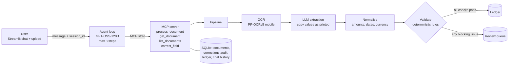

# Receipt & Invoice Extraction Agent

Finance gets receipts and invoices as photos and PDFs. This agent reads them, extracts
**vendor, date, line items, tax and total**, validates the numbers, **posts clean records**
to a ledger and sends **doubtful ones to a human review queue**. Users chat with it and can
**correct a field in chat** ("the vendor is Kedai Kopi Maju"). The record is then
re-validated and posted if it's now clean.

- **Live demo:** LIVE_URL (Streamlit Community Cloud; click a sample and watch it get posted
  or flagged)
- **Docs:** [DESIGN.md](DESIGN.md) (state, flow, every design choice, model cost and latency),
  [EVAL_REPORT.md](EVAL_REPORT.md) (before/after), [AI_USAGE.md](AI_USAGE.md)
- **Models:** GPT-OSS-120B on Groq (primary), Gemini 3.1 Flash-Lite (fallback),
  PP-OCRv5 mobile (OCR, CPU). All free tier, no training.

## What it does

| Requirement | Where |
|---|---|
| Agent, multi-turn chat with a session ID, tools behind an MCP server | [agent/agent.py](agent/agent.py), [mcp_server/server.py](mcp_server/server.py) |
| Evals: 20 cases, a score, before/after | [evals/](evals/), [EVAL_REPORT.md](EVAL_REPORT.md) |
| Test harness (pytest, fixed cases, no network) | [tests/](tests/): 155 tests |
| Security: untrusted text, injection tests, no keys in repo, PII-masked logs | [core/injection.py](core/injection.py), [core/pii.py](core/pii.py), [tests/test_pipeline.py](tests/test_pipeline.py) |
| Guardrails: timeouts, max steps, retries, validated structured output | [core/llm.py](core/llm.py), [core/extract.py](core/extract.py), [agent/agent.py](agent/agent.py) |
| Tracing: step, latency, tokens, cost | [core/tracing.py](core/tracing.py) → `traces/trace.jsonl` |
| CI: lint, tests and evals, fails below the score | [.github/workflows/ci.yml](.github/workflows/ci.yml) |
| Dockerfile | [Dockerfile](Dockerfile) |

## Architecture



The LLM *proposes* values and code *decides*. No tool can post or approve a record. Posting
happens only inside the pipeline when validation passes, so a prompt-injected model has
nothing to call that would push a bad record into the ledger.

## Setup

```bash
git clone https://github.com/Shandilya25/Invoice-and-Receipt-Extraction-Agent.git
cd Invoice-and-Receipt-Extraction-Agent
cp .env.example .env          # then put your GROQ_API_KEY (and optionally GEMINI_API_KEY) in .env
```

Free keys: [Groq](https://console.groq.com/keys), [Google AI Studio](https://aistudio.google.com/apikey).

## Run (one command)

**Without Docker** (Python 3.12+):

```powershell
# Windows (PowerShell)
py -m venv .venv; .venv\Scripts\pip install -r requirements.txt; .venv\Scripts\streamlit run streamlit_app.py
```

```bash
# Linux / macOS
python3 -m venv .venv && .venv/bin/pip install -r requirements.txt && .venv/bin/streamlit run streamlit_app.py
```

**Docker:**

```bash
docker build -t receipt-agent . && docker run --rm -p 8501:8501 --env-file .env receipt-agent
```

Open **http://localhost:8501**, then click a sample:

| Sample | What you should see |
|---|---|
| 1 · Clean receipt | Extracted and **posted** to the ledger |
| 2 · No vendor name | **Needs review** (vendor missing). Then type *"The vendor is Kedai Kopi Maju"* and it's **posted** |
| 3 · Prompt injection | Real total extracted (24.59, not the injected 0.01); **blocked** for review |
| 4 · Invoice PDF | Read from the PDF text layer and **posted** |

## Tests and evals

```bash
pip install -r requirements-dev.txt
ruff check . && ruff format --check .        # lint
pytest                                        # 155 unit tests: fake OCR/LLM, no keys needed
python -m evals.run_evals --label mine        # 20-case eval, real OCR + LLM (needs GROQ_API_KEY)
python -m evals.run_evals --compare v1 v2     # before/after table
```

The eval exits non-zero if the score is below `--min-score` (default 0.80) or if any
**unsafe post** happens. An unsafe post is a record that reached the ledger although it needed
review or had a wrong value. CI uses this as its gate.

## Results

| | v1 (baseline) | v2 (improved) |
|---|---|---|
| **Score** (0.6 × field accuracy + 0.4 × routing accuracy) | 0.899 | **0.933** |
| Field accuracy | 0.964 | **0.988** |
| Routing accuracy (right status + right flags) | 0.80 | **0.85** |
| **Unsafe posts** | **1** → CI gate fails | **0** → passes |
| Latency per document, p50 / p95 | 2.97 / 5.32 s | 5.28 / 15.43 s |
| LLM cost for all 20 cases (list price; free tier is $0) | $0.0075 | $0.0099 |

v1's unsafe post was a sideways photo whose garbled OCR produced a wrong total that happened
to add up. v2 detects and re-reads rotated pages. Details, per-case results and root causes are
in [EVAL_REPORT.md](EVAL_REPORT.md).

## Deploy (Streamlit Community Cloud, free)

1. Push this repo to GitHub (public).
2. At https://share.streamlit.io choose **Create app → Deploy a public app from GitHub**, then
   pick the repo, branch `main` and main file `streamlit_app.py`.
3. Under **Advanced settings** pick Python 3.12, and paste the secrets in TOML:
   ```toml
   GROQ_API_KEY = "gsk_..."
   GEMINI_API_KEY = "..."
   DEFAULT_CURRENCY = "MYR"
   ```
   Keys live only in Streamlit's secret store; the app copies them into environment variables
   at start-up.
4. **Deploy.** Streamlit installs `requirements.txt` plus the system packages in
   [packages.txt](packages.txt), and the OCR models (~15 MB) download on the first request.

Every `git push` to `main` redeploys automatically. For CI, add the same two keys as GitHub
**Actions secrets** (Settings → Secrets and variables → Actions).

Hugging Face Spaces was the first choice, but in 2026 Docker and Gradio Spaces on free CPU
require a paid PRO plan (the API returned `402 Payment Required`). Render's free tier (512 MB)
is too small for the OCR model. See [DESIGN.md](DESIGN.md).

## Rollback

- **Streamlit Cloud** deploys whatever is on `main`. To roll back:
  `git revert <bad-commit> && git push`, and the app redeploys the previous behaviour in about a
  minute. In an emergency, **Manage app → Reboot / Delete** in the Streamlit dashboard stops it
  immediately.
- **Docker:** tag each build with its git SHA (`docker build -t receipt-agent:$(git rev-parse --short HEAD) .`)
  and run the previous tag to roll back.
- **Gate before redeploying:** CI must pass (lint, 155 tests, eval gate with 0 unsafe posts).
- **Data:** posted records are never edited in place; corrections are kept in the `corrections`
  audit table. The SQLite file (`data/app.db`) can be backed up and restored as a single file.

## Known limits

- **Storage is ephemeral on Streamlit Cloud.** The ledger and chat history reset when the app
  restarts or sleeps after inactivity. A real deployment needs a managed database.
- **No authentication.** Anyone with the URL can use the demo (and the free-tier API quota).
- **CORD receipts always need review.** CORD (Indonesian) receipts have the store name and date
  masked, so they correctly go to review.
- **Known extraction errors that remain** (all caught as *review*, none posted):
  - On receipts without a quantity column, the model sometimes copies the price into the
    quantity (`LINE_MATH`).
  - One receipt prints the subtotal *after* the discount (`TOTAL_MISMATCH`).
  - The model once used an item name as the vendor when the store name was masked.
- **Run-to-run variance.** Extraction varies a little between runs even at temperature 0;
  one case is worth about 0.02 of the score.
- **Speed and size limits.** OCR runs on CPU at about 1–5 s per page, and sideways photos take
  ~3x longer. Only the first 3 pages of a PDF are read.
- **Throughput.** Groq's free tier (8k tokens/min) caps throughput at about 5 documents a minute.

## What I'd do next

- **Fix the two remaining extraction patterns:**
  - Tell the model that a quantity is a small count (null when there's no quantity column).
  - Accept "subtotal already after discount" as a valid layout.
- **Measure the self-check over more runs.** In v2 it ran 4 times and never produced a better
  reading, so it costs latency without a proven benefit yet. Keep it only if more runs show a gain.
- **Add a reviewer screen** to approve or fix records in the review queue, with roles.
- **Grow the eval set** to 100+ labelled receipts and run each version 3 times, reporting the
  mean and spread.
- **Infrastructure:** use Postgres instead of SQLite, and a background queue for batch uploads.

## Project layout

```
streamlit_app.py  Streamlit UI (also the Streamlit Cloud entry point)
core/             schema, OCR, LLM client, extraction, normalisation, validation, pipeline,
                  store, corrections, PII masking, injection detection, tracing
agent/            agent loop + MCP client wrapper
mcp_server/       MCP tools (stdio)
samples/          4 demo documents shown as buttons in the UI
evals/            cases.json, data/ (+ SOURCES.md), build_dataset.py, run_evals.py, results/
tests/            pytest suite (no network)
```
