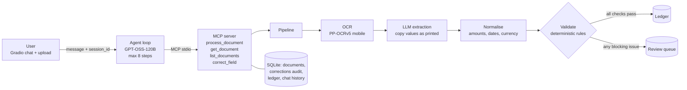

# Receipt & Invoice Extraction Agent

Finance gets receipts and invoices as photos and PDFs. This agent reads them, extracts
**vendor, date, line items, tax and total**, validates the numbers, **posts clean records**
to a ledger and sends **doubtful ones to a human review queue**. Users chat with it and can
**correct a field in chat** ("the vendor is Kedai Kopi Maju"). The record is then
re-validated and posted if it's now clean.

- **Docs:** [DESIGN.md](DESIGN.md) (state, flow, every design choice, model cost and latency),
  [EVAL_REPORT.md](EVAL_REPORT.md) (before/after), [AI_USAGE.md](AI_USAGE.md).
- **Models:** GPT-OSS-120B on Groq (primary), Gemini 3.1 Flash-Lite (fallback),
  PP-OCRv5 mobile (OCR, CPU). All free tier, no training.

## What it does

| Requirement | Where |
|---|---|
| Agent, multi-turn chat with a session ID, tools behind an MCP server | [agent/agent.py](agent/agent.py), [mcp_server/server.py](mcp_server/server.py) |
| Evals: 20 cases, a score, before/after | [evals/](evals/), [EVAL_REPORT.md](EVAL_REPORT.md) |
| Test harness (pytest, fixed cases, no network) | [tests/](tests/) |
| Security: untrusted text, injection tests, no keys in repo, PII-masked logs | [core/injection.py](core/injection.py), [core/pii.py](core/pii.py), `tests/test_pipeline.py` |
| Guardrails: timeouts, max steps, retries, validated structured output | [core/llm.py](core/llm.py), [core/extract.py](core/extract.py), [agent/agent.py](agent/agent.py) |
| Tracing: step, latency, tokens, cost | [core/tracing.py](core/tracing.py) → `traces/trace.jsonl` |
| CI: lint, tests and evals, fails below the score | [.github/workflows/ci.yml](.github/workflows/ci.yml) |
| Dockerfile | [Dockerfile](Dockerfile) |

## Architecture



The LLM *proposes* values and code *decides*. No tool can post or approve a record. Posting
happens only inside the pipeline when validation passes, so a prompt-injected model has
nothing to call that would push a bad record into the ledger.

## Setup

```bash
git clone <this repo> && cd <repo>
cp .env.example .env          # then put your GROQ_API_KEY (and optionally GEMINI_API_KEY) in .env
```

Free keys: [Groq](https://console.groq.com/keys), [Google AI Studio](https://aistudio.google.com/apikey).

## Run (one command)

**Docker:**

```bash
docker build -t receipt-agent . && docker run --rm -p 7860:7860 --env-file .env receipt-agent
```

**Without Docker** (Python 3.12+):

```bash
python -m venv .venv && .venv/bin/pip install -r requirements.txt && .venv/bin/python -m app.ui
```

On Windows use `.venv\Scripts\` instead of `.venv/bin/`.

Open http://localhost:7860, upload a receipt from `evals/data/` and try, for example,
*"The vendor on that receipt is Kedai Kopi Maju"* on `synthetic_no_vendor.png`.

## Tests and evals

```bash
pip install -r requirements-dev.txt
ruff check . && ruff format --check .        # lint
pytest                                        # unit tests: fake OCR/LLM, no keys needed
python -m evals.run_evals --label mine        # 20-case eval, real OCR + LLM (needs GROQ_API_KEY)
python -m evals.run_evals --compare v1 v2     # before/after table
```

The eval exits non-zero if the score is below `--min-score` (default 0.80) or if any record that
needed review was posted. CI uses this as its gate.

## Results

RESULTS_TABLE

Full breakdown with per-case results and root causes: [EVAL_REPORT.md](EVAL_REPORT.md).

## Deploy (Hugging Face Spaces, Docker, free CPU)

1. Create a Space at https://huggingface.co/new-space with **SDK: Docker** and **Hardware: CPU basic (free)**.
2. In the Space's **Settings → Variables and secrets**, add the secrets `GROQ_API_KEY` and `GEMINI_API_KEY`.
3. Upload the app files. The front matter at the top of this README tells Spaces to build the
   `Dockerfile` and serve port 7860:
   ```bash
   pip install huggingface_hub && hf auth login
   hf upload <your-user>/receipt-agent . . --repo-type space \
     --exclude "evals/*" "tests/*" "data/*" ".env" ".venv/*" "traces/*" "uploads/*" ".git/*"
   ```
4. The Space builds the image (the OCR models are downloaded during the build) and starts on its URL.

**CI on GitHub:** add the same two keys as repository secrets
(**Settings → Secrets and variables → Actions**) so the eval job can run.

## Rollback

- **Hugging Face Space:** every upload is a commit in the Space repo. Open the Space's
  **Files → History**, pick the last good commit and revert it (or re-upload from the matching
  git tag: `git checkout <good-tag> && hf upload ...`). The Space rebuilds from that commit.
- **Docker:** tag each build with its git SHA (`docker build -t receipt-agent:$(git rev-parse --short HEAD) .`)
  and run the previous tag to roll back.
- **Code:** `git revert <bad-commit>`. CI must pass (lint, tests, eval gate) before you redeploy.
- **Data:** posted records are never edited in place; corrections are kept in the `corrections`
  audit table. The SQLite file (`data/app.db`) can be backed up and restored as a single file.

## Known limits

- The Space's disk is not persistent on the free tier, so the ledger and chat history reset
  when it restarts. A real deployment needs a managed database.
- CORD (Indonesian) receipts have the store name and date masked, so they always need review.
  That's correct behaviour, but it means the "posted" path is only exercised on Malaysian
  receipts and the synthetic invoice.
- Extraction has some run-to-run variance even at temperature 0, so a case can flip between
  runs (see EVAL_REPORT.md). The validation rules catch these as review, not as wrong posts.
- OCR runs on CPU at about 1–5 s per page, or ~3x that for sideways photos (auto-rotation tries both
  directions). Only the first 3 pages of a PDF are read.
- No authentication or roles: anyone with the URL can chat and see the ledger. This is fine for
  a demo but not for real finance data.
- Free-tier rate limits (Groq: 8k tokens/min) cap throughput at about 5 documents a minute.

## What I'd do next

- Add a reviewer screen to approve or fix records in the review queue (today it's view-only),
  with role-based access.
- Use a vision model as a second opinion on low-quality images and compare its reading with
  OCR + LLM. Disagreement would route to review.
- Grow the eval set to 100+ labelled receipts, run each version 3 times and report the mean,
  so the noise is measured rather than estimated.
- Use Postgres instead of SQLite, and a background queue for batch uploads.
- Feed every chat correction (wrong value, right value) back into the eval set automatically.

## Project layout

```
core/         schema, OCR, LLM client, extraction, normalisation, validation, pipeline,
              store, corrections, PII masking, injection detection, tracing
agent/        agent loop + MCP client wrapper
mcp_server/   MCP tools (stdio)
app/          Gradio UI
evals/        cases.json, data/ (+ SOURCES.md), build_dataset.py, run_evals.py, results/
tests/        pytest suite (no network)
```
